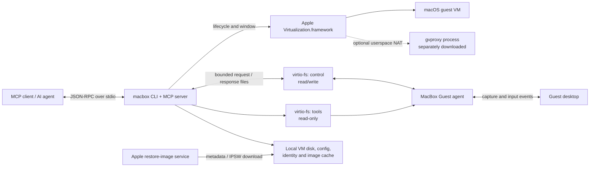

# MacBox

[](Package.swift)
[](Package.swift)


MacBox gives an AI agent a separate macOS desktop to observe and operate without posting input to the host desktop. It combines Apple's Virtualization framework, a guest-side screen and input agent, and a local Model Context Protocol (MCP) server over stdio.

> **Status: experimental prototype, not production-ready.** A VM has booted and the guest agent has responded over the control channel, but full guest acceptance—including granted permissions, screenshots, input, updates, and networking—has not been completed. Do not use it for sensitive or high-impact workloads without further validation. The host OS, guest OS, and required macOS permissions remain part of the trust boundary.

## Engineering highlights

- **Guest-scoped desktop control.** `MacBoxGuest` checks `hw.model` before running and uses guest-side CoreGraphics events and screen capture. The check prevents accidental execution on a physical Mac; it is not attestation.
- **A bounded local control protocol.** The host and guest exchange versioned, length-prefixed JSON through a dedicated virtio-fs mailbox. Requests carry UUIDs and expiration times; file reads reject symbolic links, hard links, non-regular files, and oversized payloads.
- **Explicit action outcomes.** MCP can return a screenshot after an action. If capture fails after the action succeeded, the response says that the action completed, so callers can check the result before retrying.
- **Lifecycle and recovery primitives.** The VM uses sparse disk storage and a process lock. Restore-image downloads can retain URLSession resume data when available; installation uses Apple restore-image metadata and refuses to overwrite an existing VM directory.
- **Update identity checks.** The guest update path stages a candidate, checks it against the installed app's designated code requirement, swaps bundles, and keeps the old bundle for rollback. Automatic login registration and updates have not been validated end to end in a guest.
- **Change-aware screenshots.** A client can supply the previous PNG's SHA-256 to omit identical image bytes. Each request still captures and encodes a screenshot; this is not a streaming viewer or a demonstrated CPU optimization.

## Architecture



- **`Sources/MacBoxCLI`** implements CLI commands, the stdio MCP server, and the native `VZVirtualMachineView` window.
- **`Sources/MacBoxCore`** builds and installs VMs, manages storage and locks, checks readiness and code signatures, and provides the optional network bridge.
- **`Sources/MacBoxProtocol`** defines the message schema, validation limits, framing, and file-based mailbox.
- **`Sources/MacBoxGuest`** handles guest capture, input, permission status, login-item registration, and staged updates.

The repository does not include an LLM, model provider integration, database, web server, or Docker deployment. The MCP client supplies the AI model and its own instruction and safety policies.

## Stack

| Layer | Implementation | Role in this project |
| --- | --- | --- |
| Language and build | Swift 6, Swift Package Manager | Builds the host CLI, guest executable, protocol, and tests. |
| VM runtime | Apple Virtualization framework | Installs and runs a macOS guest on Apple Silicon. |
| Desktop | AppKit, CoreGraphics, ApplicationServices | Provides the native VM window and guest-side screenshot/input operations. |
| Agent interface | MCP-style JSON-RPC over stdio | Exposes desktop actions to a compatible local client. No model is bundled. |
| Storage and transport | Local sparse disk, JSON metadata, virtio-fs mailbox | Persists guest state and exchanges bounded local messages; no database is used. |
| Identity and secrets | Security framework, Keychain, CryptoKit | Checks code requirements, generates selected secrets, and hashes screenshot bytes. |
| Optional networking | `gvproxy` v0.9.0 | Supplies an optional user-space NAT path; it is separately downloaded, not a Swift package dependency. |

## Repository layout

```text
.
├── Package.swift                 # Swift package and targets
├── setup.sh                      # Build and start guided first run
├── config/MacBox.entitlements    # Host virtualization entitlement
├── scripts/                      # Signing and optional network-helper download
├── Sources/
│   ├── MacBoxCLI/                # CLI, MCP server, native VM window
│   ├── MacBoxCore/               # Agent, VM, storage, network, diagnostics
│   ├── MacBoxGuest/              # Guest application
│   └── MacBoxProtocol/           # Message protocol and mailbox
├── Tests/MacBoxCoreTests/        # Swift Testing suites
├── docs/                         # Historical plan, decisions, checklist
└── SECURITY.md                   # Trust boundaries and disclosure guidance
```

## Quickstart

### Requirements

- Apple Silicon Mac running macOS 14 or later; Swift 6 and Xcode or Command Line Tools.
- Internet access for Apple's compatible restore image, unless supplying a local IPSW. Allow substantial disk space for the image and VM disk; the default disk is a 64 GiB sparse file, not a 64 GiB upfront allocation.
- A logged-in guest session and guest-side Screen Recording and Accessibility permissions. The first guest setup and first agent launch are interactive in the current implementation.
- A compatible MCP client if using an AI agent. No API key is required by MacBox itself.

```sh
git clone https://github.com/urdzik-dev/macbox.git
cd macbox
./setup.sh --plan  # builds and signs; prints the VM plan without installing a VM
./setup.sh         # builds, downloads/reuses an image, installs and opens the default VM
```

On the first guest boot, complete macOS setup, then open `/Volumes/My Shared Files/tools/MacBoxGuest.app` inside the guest and follow the permission prompts. The agent attempts to install a guest-local copy and register a login item; system approval may be required. These steps do not grant host screen or Accessibility permissions to the guest agent.

```sh
# Inspect host and guest readiness after a release build
.build/release/macbox doctor
.build/release/macbox ready default --json

# Use an existing local Apple restore image instead of downloading one
./setup.sh work --ipsw /absolute/path/to/Restore.ipsw

# Run the automated tests
swift test
```

`ready` checks the lock, guest permission status, and whether a valid PNG can be obtained. It does **not** perform a test click or key press. CLI output and errors currently include Ukrainian text.

### Configuration

There is no `.env` file or dotenv loader. Set environment variables in the invoking process when needed.

| Variable | Required | Default | Purpose |
| --- | --- | --- | --- |
| `MACBOX_DATA_DIR` | No | `~/.macbox` | VM and image-cache root; global `--data-dir` takes precedence. |
| `MACBOX_SIGN_IDENTITY` | No | `-` | Code-signing identity used by the build script; `-` means ad-hoc signing. |
| `MACBOX_BUILD_NUMBER` | No | Current Unix timestamp | Positive numeric guest-bundle build version used by the build script. |
| `MACBOX_GVPROXY_TEST` | No | Unset | Path to a real `gvproxy` executable for an optional automated test. |

Ad-hoc signing is convenient for development but generally changes the designated identity across rebuilds; guest privacy approvals and automatic updates may not survive. The project does not include a license file or notarized release configuration. The separately downloaded `gvproxy` project is Apache-2.0 licensed.

### Optional user-space networking

```sh
bash scripts/install-network-helper.sh
.build/release/macbox start work --vpn-proxy "$PWD/vendor/gvproxy/gvproxy"
```

The helper script downloads the pinned upstream `gvproxy` v0.9.0 binary and checks its SHA-256. This mode uses a private Unix datagram socket and a random API token, with default SSH forwarding disabled. It has been exercised at the host process/socket level, not validated end to end inside the guest or with a specific VPN. It is NAT, not a guarantee of VPN routing or LAN isolation.

## MCP usage

Configure a client with the absolute path to the signed executable:

```json
{
  "mcpServers": {
    "macbox": {
      "command": "/absolute/path/to/macbox/.build/release/macbox",
      "args": ["mcp"]
    }
  }
}
```

The server uses newline-delimited JSON-RPC on stdin/stdout, not HTTP. The following read-only example queries the VM configuration; replace `default` with the name of an existing VM:

```sh
printf '%s\n' '{"jsonrpc":"2.0","id":1,"method":"tools/call","params":{"name":"vm_status","arguments":{"vm":"default"}}}' | .build/release/macbox mcp
```

Representative response for a configured VM (the `text` field is itself JSON):

```json
{"id":1,"jsonrpc":"2.0","result":{"content":[{"type":"text","text":"{\"cpuCount\":4,\"installed\":true,\"locked\":false,\"memoryGiB\":8,\"name\":\"default\"}"}]}}
```

Available tools are `vm_status`, `status`, `screenshot`, `click`, `move`, `drag`, `scroll`, `type`, and `key`; each accepts `vm`. The six input actions accept `screenshot: true`. `screenshot` accepts `if_hash` with the prior SHA-256 to return an unchanged status instead of repeating identical image bytes. Coordinates are guest display points in the returned image; HiDPI alignment requires live verification.

## Trade-offs and next steps

1. **Complete live acceptance:** verify guest setup, permissions, screenshots, coordinate alignment, input, login-item registration, updates, and networking on a real guest.
2. **Harden the trust boundary:** add explicit MCP-client authorization and stronger isolation, bound MCP input, and test malformed or adversarial guest responses. See [SECURITY.md](SECURITY.md).
3. **Make first run recoverable:** test interrupted IPSW downloads and installation failures; do not assume resume data will always be available or usable.
4. **Validate newer-platform provisioning:** the macOS 27 first-boot path is conditional on a matching SDK and host; it has not been built or tested here and does not grant guest privacy permissions.
5. **Measure before optimizing:** benchmark action latency, image size, resource use, and failure rates in real guest sessions. The current native window is not a terminal video stream.

Historical [planning](docs/PLAN.md), [decisions](docs/DECISIONS.md), and [checklist](docs/CHECKLIST.md) documents describe goals and hypotheses, not a verified feature inventory.
